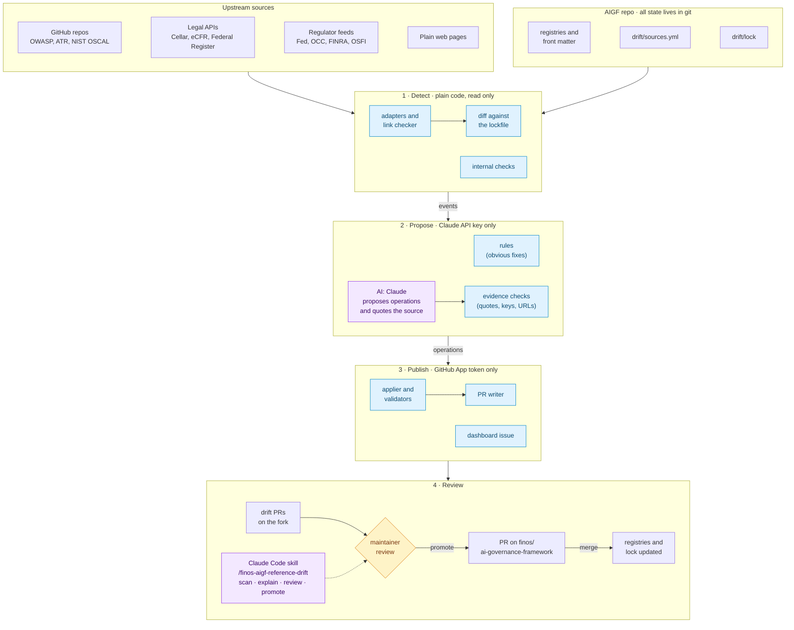

# AIGF reference drift

Draft design for #377 and #413, for discussion. The scope is narrow. Every external reference AIGF cites (OWASP, NIST, ISO, EU AI Act, SR 11-7, UK, Canada, and the US set in #374) should stay true to its source, and every fix should reach the maintainers as a pull request we review. Nothing merges on its own.

## Why we need it

`validate-references.py` checks that the YAML has the right shape. Nothing checks that it still matches the source. A quick look at `main` (`657f11e`) on 21 October found:

- `ri-30` still maps `llm03-2025` and `llm06-2025`, two keys that #354 superseded.
- Every URL in `sr11-7.yml` returns 404. SR 26-2 replaced SR 11-7 in April 2026, and it leaves generative and agentic AI out of scope, so the fix is more than a URL swap.
- `eu-ai-act.yml` predates the Digital Omnibus (Regulation (EU) 2026/1744, in force since 27 July 2026), which replaces Article 4 and adds Articles 4a, 60a and 75a to 75c.
- All ten OWASP ML Top 10 links redirect to `owasp.github.io`, and the project page is gone.
- `ca-7` is titled "CA-7 Authorization", but CA-7 is Continuous Monitoring, and nine mitigations cite it. The registry also links the 2020 PDF of SP 800-53, which predates release 5.2.0 (August 2025).
- 19 risk ids ended up inside `uk-regulations_references` in seven risk files (the bug in #367).

The `dl_*.py` downloaders can't help here. They still write the layout from before the registries existed, and they regenerate whole files, therefore running one today would wipe hand-edited fields such as `superseded_by`.

NB: a naive link checker would make things worse. In the same run, 120 of the 134 failing URLs were sites blocking bots (110 from the FFIEC handbook alone), and the NIST SP 800-53 PDF answers 404 to `HEAD` and 200 to `GET`.

## How it works

We could treat each registry in `docs/_data/references/` the way Dependabot treats a package. A lockfile in `drift/lock/` records what the upstream source looked like the last time a maintainer accepted it. A scheduled job fetches each source, compares it with the lock, and turns every difference into an event (a link moved, a title changed, a new edition came out, an entry was withdrawn, an article was amended).

## Architecture

Purple boxes use AI (Claude), blue boxes are plain code, and the amber diamond is a human.

| Component | What it does |
|---|---|
| `drift/sources.yml` | lists each registry's upstream source, the adapter that reads it, and per-host rules (rate limits, browser fetch) |
| lockfile (`drift/lock/`) | the upstream state a maintainer last accepted by merging a PR |
| adapters | one per kind of source (GitHub repo, OSCAL, Cellar, eCFR and Federal Register, RSS feed, web page), each turning its source into the same normalised snapshot |
| link checker | fetches every entry URL with `GET`, tells "unknown" from "dead", and waits for two failures a week apart |
| internal checks | catch keys that don't exist and mappings to superseded entries (could reuse `review-pr.py` from #362) |
| rules | plain code fixes for the events with an obvious answer |
| AI step (Claude) | proposals for the events that need judgement, as JSON only, without repo access |
| evidence checks | make sure every quote is in the source, every key exists and every URL loads. Anything that fails goes to the dashboard |
| applier and validators | apply the operations with a YAML editor that keeps comments, then run `validate-references.py` |
| PR writer and dashboard | open or update the PRs and rewrite the pinned issue |
| `/finos-aigf-reference-drift` (Claude Code skill) | runs the same pipeline from a laptop and helps with reviewing and promoting PRs |

## How each source is read

Each source gets read through the most structured feed it has. Scraping is the fallback, not the default.

| Source | How we detect a change |
|---|---|
| OWASP LLM Top 10 | a new year folder in the GitHub repo means a new edition, and commits under `2026/final` mean edits. The repo also ships its own mappings to ASI, ATLAS and NIST in `2026/final/mappings/` |
| OWASP Agentic Top 10 | it has no git source, so we watch `modified_gmt` in the genai.owasp.org WordPress API and hash the PDF |
| OWASP ML Top 10, ATR | GitHub releases and commits. Each ATR rule's YAML carries a `status` (draft, experimental, stable, deprecated) and a `replaced_by` |
| NIST SP 800-53 | `metadata.version` of the OSCAL catalog in `usnistgov/oscal-content` (5.2.0 today). A withdrawn control points at its replacement |
| NIST AI 600-1, FFIEC, IOSCO | none of them has a structured feed, so we check the PDFs and pages (FFIEC also has a "What's new" page) |
| EU AI Act | Cellar SPARQL plus the branch notice, which lists each amended article with its date |
| US rules (#374) | the eCFR versioner and the Federal Register API (amendments, proposed rules, comment deadlines) |
| SR letters, OCC, FINRA | their RSS feeds, plus the `Supersedes:` block on each SR letter |
| UK and Canada | legislation.gov.uk change feeds, the Justice Canada XML repo on GitHub, the OSFI and FCA feeds |
| ISO/IEC 42001 | the daily ISO Open Data metadata file (record 81230). The text is paywalled, so we store hashes and never text |
| everything else | a hash of the page's main content, plus a link check |

Two rules keep the link check quiet. A 403, a 429 or a 5xx counts as "unknown" rather than "dead", and a link has to fail twice, a week apart, before anything happens. We also watch forward. The Fed deleted the SR 11-7 page instead of marking it superseded, so a 404 on a regulator's site starts a search through that regulator's feeds for whatever replaced it.

## What plain code fixes and where AI comes in

Most events have an obvious fix, and plain code applies it.

| Event | Fix | Done by |
|---|---|---|
| link moved to the same document | update `url` | code |
| title changed upstream | update `title` | code |
| mapping points at a superseded key with one successor (`ri-30`) | remap it | code |
| front matter cites a key that doesn't exist (#367) | flag it | code |
| link dead with no redirect | find the new URL | AI, then code re-fetches it |
| new edition (OWASP 2025 → 2026) | new keys, `superseded_by`, remaps | AI |
| entry superseded or withdrawn (SR 11-7, the CFPB circulars) | set `status`, propose remaps | AI |
| article or rule amended | say whether our mapping still holds | AI (often an issue rather than a PR) |
| proposed rule with a comment deadline | dashboard entry only | code |

The AI step (Claude, called through the API) never edits files. It gets one event, plus the registry entries and front matter lines it touches. It returns JSON holding a list of operations from a short fixed set (`set_status`, `mark_superseded`, `remap_reference` and a few more) and a quote from the source for each claim. Code then checks that every quote appears in the fetched page, that every key exists and that every URL loads. Only after that does code apply the operations and run `validate-references.py` and `review-pr.py`. When a check fails or Claude abstains, the event goes on the dashboard together with the reason.

This has two useful side effects. The same proposal always produces the same diff, and proposals are cached by their inputs (prompt version, model, source hashes), so a re-run against an unchanged source leaves the PR alone. We also get the feedback loop #413 asks for. Comparing the merged diff with the original proposal tells us whether a PR went in as proposed, went in with edits, or was closed.

Status changes need three optional fields in the registry schema: `status` (in force, proposed, withdrawn, superseded, repealed), `status_date` and `status_source`. The validator should also fail on keys that don't exist and warn on mappings to superseded entries. Those two checks would have caught `ri-30` and #367 in CI.

## Pull requests

We open one PR per dataset and kind of change, so the ten OWASP ML link fixes arrive together. Branch names come from a hash of the event, therefore a re-run updates the open PR instead of opening a second one. Merging a PR updates the lockfile. Closing one keeps the bot quiet about that change until the source moves again.

At most five drift PRs are open at once. The rest wait on a single pinned issue that each run rewrites. It also lists upcoming comment deadlines (comments on the new TPRM guidance close on 16 November, for example), and it could be a standing item on the fortnightly call.

Each PR body links the source and the evidence. It shows a before and after table, the risks and mitigations that cite the changed entries, and whether the change is Fast Track (§2.3) or needs consensus (§2.1). Link fixes, title fixes and one-to-one remaps should be Fast Track. Everything else gets `governance-needed`.

## Where it runs

The scheduled job runs as three separate steps, so no step holds both the Claude API key and write access. Detection only reads. The AI step has the API key and nothing else. Publishing has a GitHub App token and no API key. (The App token matters because PRs opened with the default `GITHUB_TOKEN` don't trigger other workflows, so the validators would never run on them.)

We could start on a maintainer's fork (mine, to begin with). The bot opens PRs against `stefanoamorelli/ai-governance-framework`, the maintainer reviews them there, and the good ones get re-opened upstream under the maintainer's name and sign-off. That needs no FINOS budget, secret or GitHub App, and nothing public goes out from a FINOS bot before it has a track record. Once it works, the code-only part can move upstream as a normal CI change, and the AI part can follow when #371 settles hosting and budget.

The config pins the model (`claude-opus-5-5`). Runs go through the Batches API because nothing is urgent, and a fortnightly run should cost a few dollars.

## The skill

`/finos-aigf-reference-drift` is a Claude Code skill on top of the same Python code the scheduled job runs, so a laptop and CI behave the same way.

| Command | What it does |
|---|---|
| `scan` | runs detection and lists the events |
| `explain <event>` | shows the evidence and what in AIGF cites the entry |
| `pr <event>` | opens or updates the PR |
| `review <pr>` | re-fetches the evidence, checks the quotes, shows what a human changed compared with the proposal |
| `promote <pr>` | re-opens a fork PR upstream with the maintainer's sign-off |
